# 📊 UIII Act4  Importación y descripción de datos con Pandas ML
## Alonso López García NC = 0087 | Fecha 11/11/2026
> **🎓 Asignatura:** Soluciona problemas de Machine Learning  
> **📚 Nivel:** Tercer semestre de preparatoria  
> **🤖 Especialidad:** Inteligencia Artificial  
> **📈 Dificultad:** Cero a principiante  
> **🐍 Lenguaje:** Python  
> **🛠️ Herramientas:** Visual Studio Code, Pandas, Matplotlib y CSV  

# Control de plagas 
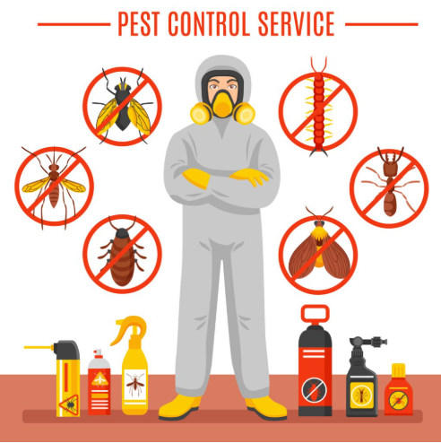

### Tabla original registro de plagas 
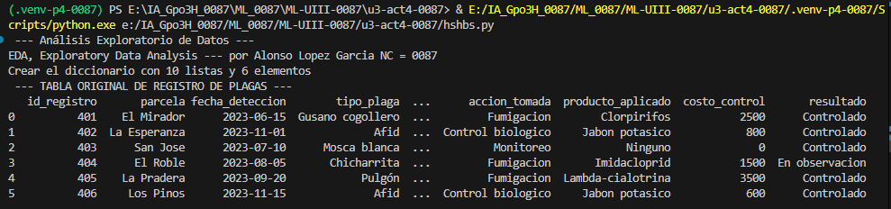

### Convertir el archivo en DataFrame
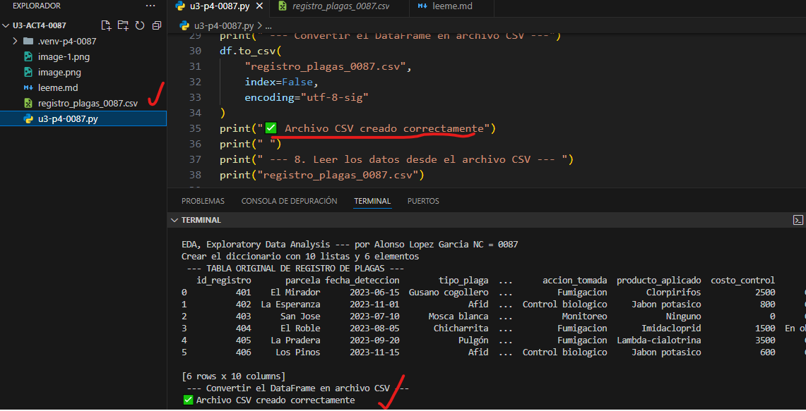

### Datos del CSV --> Base de datos
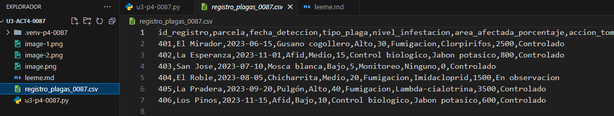

### Leer los datos desde el archivo CSV
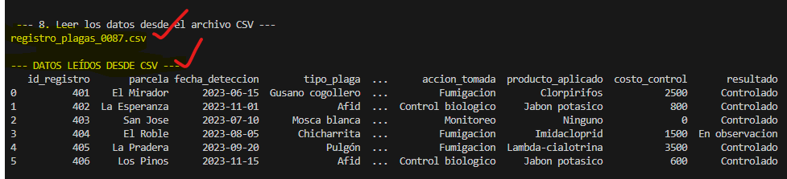

### Análisis Exploratorio de Datos (EDA)
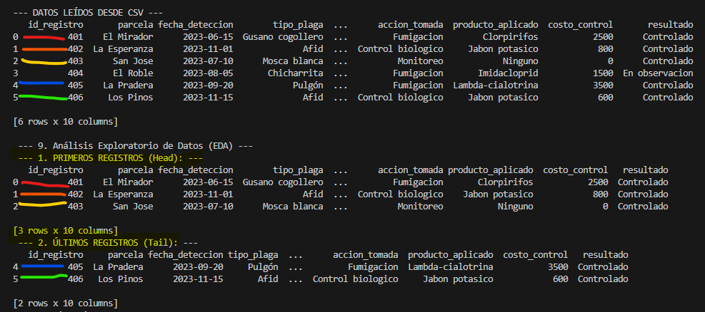

### Dimensiones y estructura
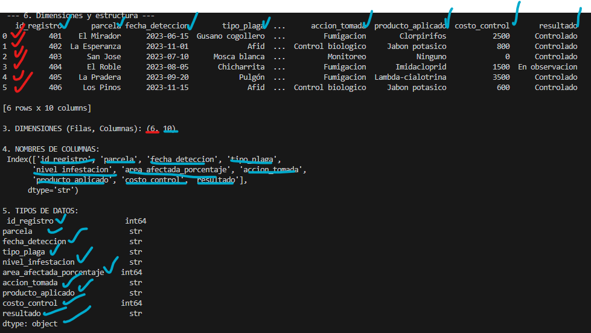

### Estadísticas descriptivas 
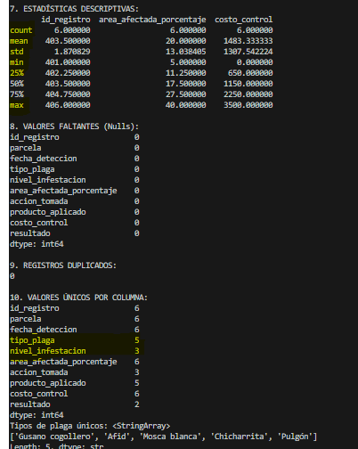

### Análisis específico | 9. Ordenamiento, filtrado y agrupación
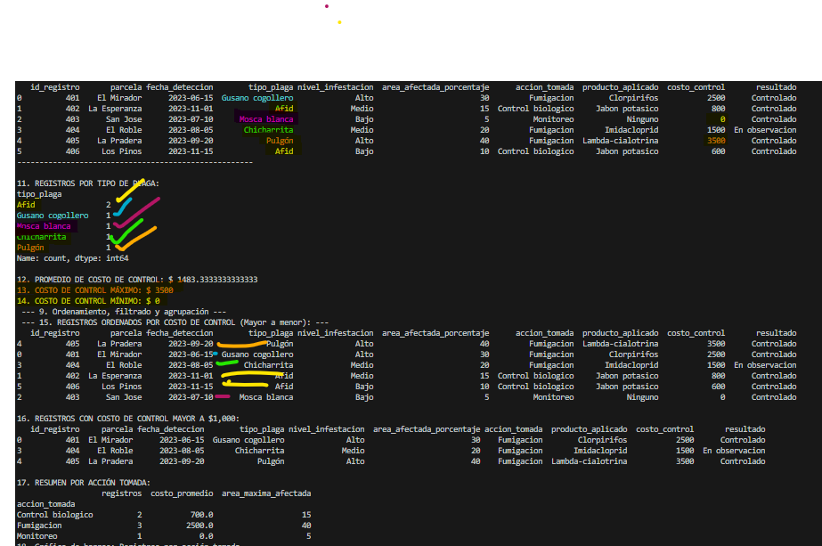

### Grafica de barras registros por accion tomada 
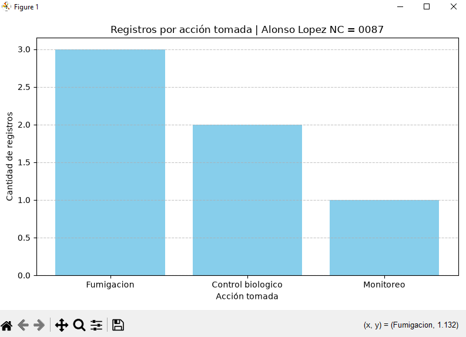

### Grafica de barras costo de control por parcela  
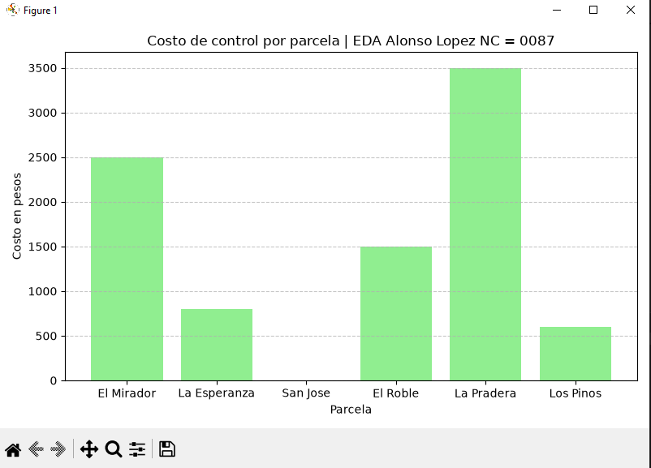

### Histograma distribucion de area afectada
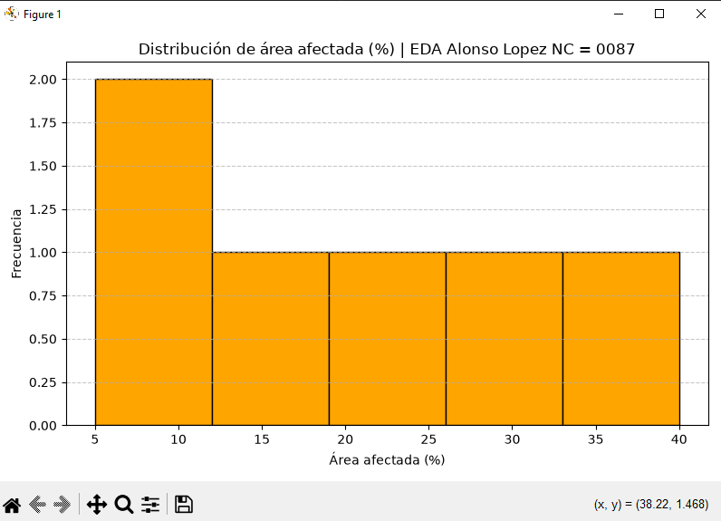

### Grafica de dispersion relacion entre area afectada y costo de control
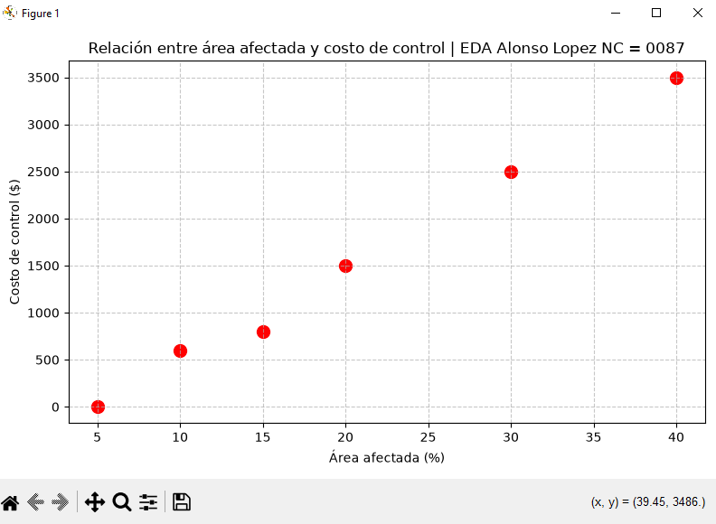

### Diagrama de caja: distribucion de costos de control 
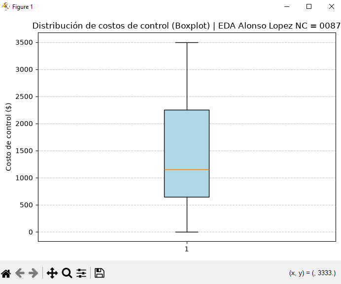

### Matriz de correlación
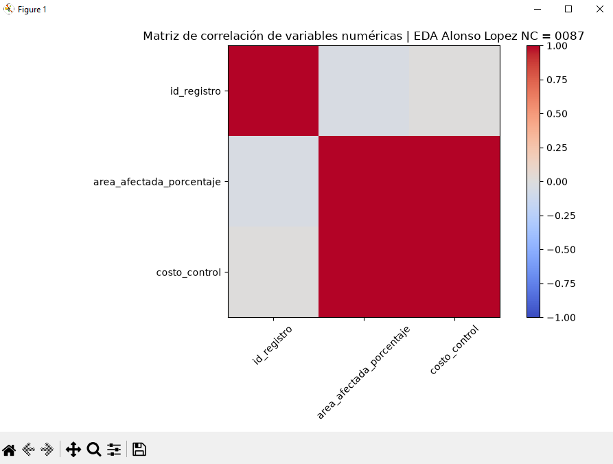